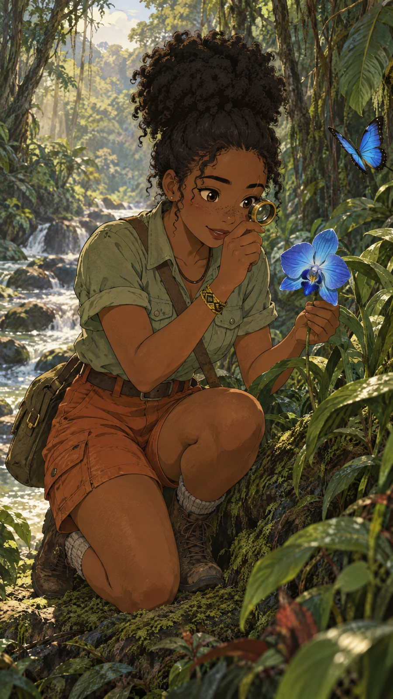
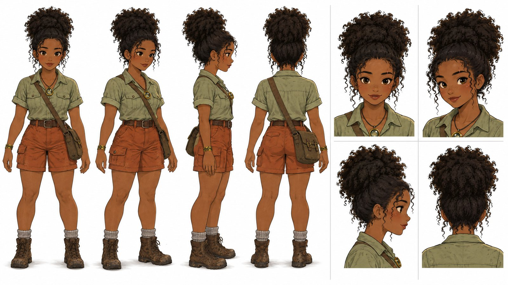
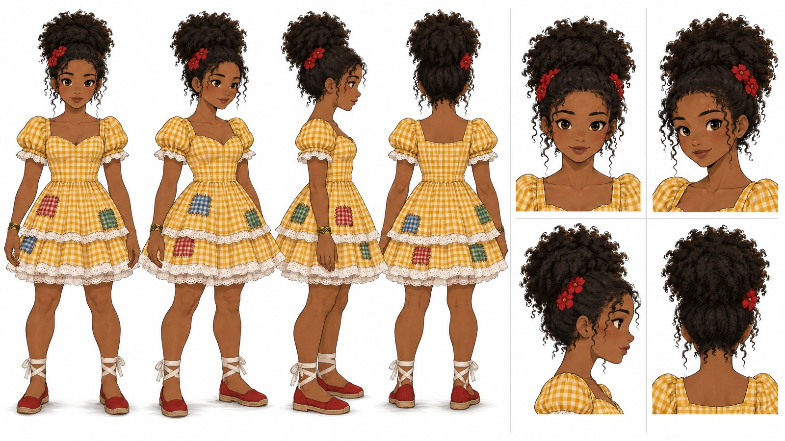
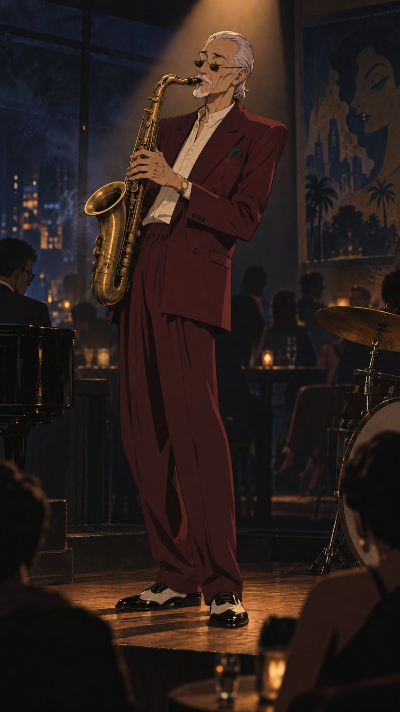
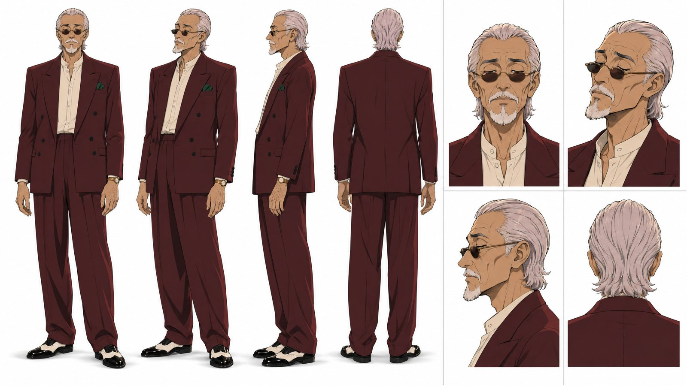
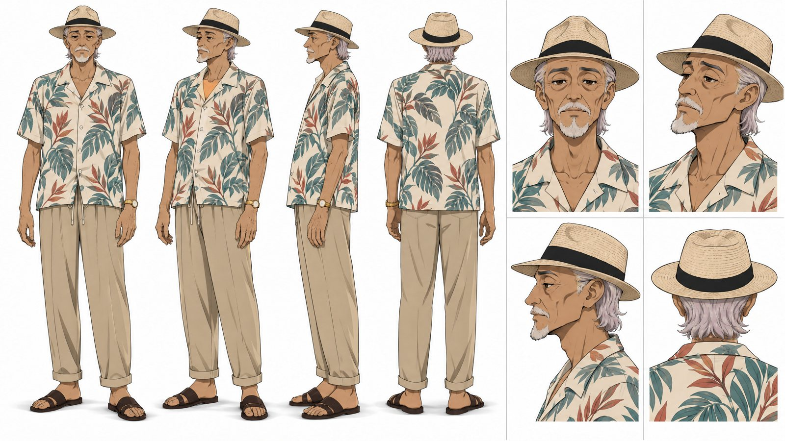
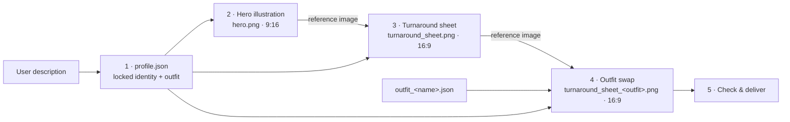

# Character Turnaround Sheets

[](https://github.com/talvanes/character-turnaround-sheets/actions/workflows/tests.yml)
[](LICENSE)


An agent skill for **designing an original illustrated character and keeping it visually consistent across images**. From a text description, it produces:

1. a **hero illustration** of the character in a scene;
2. a **16:9 turnaround / model sheet** on white: front, three-quarter, side and back full-body views, plus a 2x2 grid of face views;
3. **outfit-swap variants** of that sheet, where only the clothes change and the character's identity stays the same.

Image models drift: faces change between generations, accessories migrate or reappear, skin tones shift under colored light. This skill avoids that drift by building every prompt from **one locked character profile** and passing the **latest image as a reference** at every step.

The skill was written for [Manus](https://manus.im), but the prompt builder is a plain, dependency-free Python script. You can use it with any image-generation model that accepts a text prompt and, ideally, a reference image.

---

## Table of contents

- [Showcase](#showcase)
- [How it works](#how-it-works)
- [Repository layout](#repository-layout)
- [Installation](#installation)
- [Quick start](#quick-start)
- [The character profile](#the-character-profile)
- [Outfit files](#outfit-files)
- [CLI reference: `build_prompt.py`](#cli-reference-build_promptpy)
- [Anatomy of a generated prompt](#anatomy-of-a-generated-prompt)
- [Accessory control and automatic "Avoid" items](#accessory-control-and-automatic-avoid-items)
- [Quality checklist](#quality-checklist)
- [Known failure modes](#known-failure-modes)
- [Development and testing](#development-and-testing)
- [Limitations](#limitations)
- [Contributing](#contributing)
- [License](#license)

---

## Showcase

All images below were generated with this skill from the profiles in [`examples/`](examples). They are AI-generated and shown without retouching, so they include the small deviations noted in the captions.

### Marina, botanist explorer (storybook gouache style)

| Hero illustration | Turnaround sheet |
| --- | --- |
|  |  |

**Outfit swap: festa junina** ([`outfit_festa_junina.json`](examples/marina/outfit_festa_junina.json))



The satchel, belt and loupe were removed as the outfit notes requested, and the bracelet stays on her RIGHT wrist. The model rendered the dress as yellow-and-white gingham rather than a small red-and-white print.

### Benedito, retired jazz saxophonist (1990s jazz-noir anime style)

| Hero illustration | Turnaround sheet |
| --- | --- |
|  |  |

**Outfit swap: Sunday look** ([`outfit_domingo.json`](examples/benedito/outfit_domingo.json))



The suit jacket, sunglasses and pocket square are gone, the panama hat and sandals were added, and the gold watch stays on his LEFT wrist. In the base sheet the jacket was drawn buttoned, although the profile says unbuttoned.

---

## How it works



| Stage | Input | Output | Aspect ratio | Reference image |
| --- | --- | --- | --- | --- |
| 1. Profile | User's description | `profile.json` | — | — |
| 2. Hero | Profile + scene text | `hero.png` | 9:16 (or user's choice) | none |
| 3. Turnaround | Profile | `turnaround_sheet.png` | 16:9 | hero image (or a user-supplied sheet) |
| 4. Outfit swap | Profile + `outfit_<name>.json` | `turnaround_sheet_<outfit>.png` | 16:9 | most recent sheet |
| 5. Check | Generated image | Delivery notes | — | — |

Three principles keep the character consistent:

- **One source of truth.** Every prompt restates the same identity block (body, heritage, skin, eyes, face, hair) and the full art-style string, word for word.
- **Reference chaining.** Each new image is generated with the previous one as a reference, and `--with-reference` adds explicit identity-lock wording.
- **Exhaustive outfits.** Garments, footwear and accessories are listed in full. Anything not listed is ignored, and common carry-over items are explicitly forbidden.

The agent-facing instructions live in [`SKILL.md`](SKILL.md). Lessons learned and outfit-writing patterns live in [`references/lessons.md`](references/lessons.md).

---

## Repository layout

```text
character-turnaround-sheets/
├── SKILL.md                         # Agent instructions (name + description frontmatter)
├── scripts/
│   └── build_prompt.py              # Prompt builder (stdlib only)
├── templates/
│   └── character_profile.json       # Profile schema with a filled example
├── references/
│   └── lessons.md                   # Failure modes, outfit-writing guide, ambiguity rules
├── examples/
│   ├── marina/                      # profile.json + outfit_festa_junina.json
│   └── benedito/                    # profile.json + outfit_domingo.json
├── docs/images/                     # Showcase images used in this README
├── tests/
│   └── test_build_prompt.py         # unittest suite (26 tests)
├── .github/workflows/tests.yml      # CI on Python 3.8 and 3.12
├── LICENSE                          # MIT
└── README.md
```

Only `SKILL.md`, `scripts/`, `templates/` and `references/` are needed at runtime. Everything else is documentation, examples and tests.

---

## Installation

### As a Manus skill

The skill expects to live at `/home/ubuntu/skills/character-turnaround-sheets/`, because that is the path used in `SKILL.md`. Add it to Manus through your skills settings, either by importing this repository or by uploading a zip of the runtime files:

```bash
git clone https://github.com/talvanes/character-turnaround-sheets.git
cd character-turnaround-sheets
zip -r character-turnaround-sheets.zip SKILL.md scripts templates references
```

Once installed, invoke it by name (`/character-turnaround-sheets`) or simply ask for a character sheet, a turnaround, a model sheet, or "the same character wearing X". The skill description is written to trigger on those requests.

### As a standalone tool

Clone the repository; there is nothing to install. Requires **Python 3.8+** and only the standard library.

```bash
git clone https://github.com/talvanes/character-turnaround-sheets.git
cd character-turnaround-sheets
python3 scripts/build_prompt.py --help
```

Paste the generated prompts into the image model of your choice. For stages 3 and 4, attach the previous image as a reference or image-prompt input if your model supports it.

---

## Quick start

```bash
# 1. Create a profile from the template and edit it
mkdir -p output/mychar
cp templates/character_profile.json output/mychar/profile.json

# 2. Hero prompt (generate at 9:16, save as hero.png)
python3 scripts/build_prompt.py output/mychar/profile.json --mode hero \
  --scene "kneeling on a riverbank at dawn, studying a glowing orchid, morning mist"

# 3. Turnaround prompt (generate at 16:9 with hero.png as reference)
python3 scripts/build_prompt.py output/mychar/profile.json --mode turnaround --with-reference

# 4. Outfit swap prompt (16:9, latest sheet as reference)
python3 scripts/build_prompt.py output/mychar/profile.json --mode turnaround \
  --outfit output/mychar/outfit_winter.json --with-reference
```

Try it on the bundled examples:

```bash
python3 scripts/build_prompt.py examples/benedito/profile.json --mode turnaround \
  --outfit examples/benedito/outfit_domingo.json --with-reference
```

> The `output/` directory is git-ignored, so your own characters and generated images are never committed by accident.

---

## The character profile

A profile is a single JSON object. Fields marked *required* must be non-empty strings; the script exits with a clear error if any is missing.

| Field | Required | What it locks | Example (Marina) |
| --- | --- | --- | --- |
| `name` | no | File/slug name for your own bookkeeping | `marina_botanist_explorer` |
| `art_style` | yes | Rendering style, repeated in full in every prompt | `hand-painted storybook illustration with clean confident ink linework, flat cel-shaded color with subtle gouache texture…` |
| `body` | yes | Build, age, height, proportions | `petite, wiry and athletic adult woman in her late twenties…` |
| `heritage` | yes | Ancestry cues for facial features | `Afro-Brazilian features` |
| `skin` | yes | Base skin tone (guarded against lighting drift) | `deep warm brown skin` |
| `eyes` | yes | Eye shape and color | `large dark-amber eyes` |
| `face` | yes | Distinctive facial features | `round face… freckles… a tiny scar through her LEFT eyebrow` |
| `hair` | yes | Hairstyle (persistent; update it when it changes) | `voluminous natural coily black hair gathered into a large high puff…` |
| `outfit` | no | Default outfit (see [Outfit files](#outfit-files)) | field shirt, cargo shorts, satchel, boots, loupe, bracelet |

Profile-writing rules:

- **Keep the user's exact descriptors.** Do not paraphrase traits away.
- **Name the body side** for anything asymmetric: "scar through her LEFT eyebrow", "watch on his LEFT wrist".
- **Update the profile** when a persistent trait changes (for example a new haircut), so every later sheet inherits it.
- Be specific about color nuance ("dark charcoal, not pure black") and materials.

See [`templates/character_profile.json`](templates/character_profile.json) for a complete example.

---

## Outfit files

An outfit uses the same schema as `profile.outfit`. Pass it with `--outfit` to replace the profile's outfit for one sheet.

```json
{
  "garments": [
    "loose short-sleeved camp-collar shirt in soft cream linen with a muted teal and terracotta tropical leaf print, worn untucked",
    "light khaki cotton drawstring trousers, relaxed straight leg, cuffs rolled once at the ankle"
  ],
  "footwear": "simple dark-brown leather slide sandals",
  "accessories": [
    "slim gold wristwatch on his LEFT wrist",
    "woven straw panama hat with a black band"
  ],
  "notes": "No suit jacket, no sunglasses, no pocket square, no tie."
}
```

| Key | Type | Behavior |
| --- | --- | --- |
| `garments` | list of strings (a single string is accepted) | One bullet per garment. Describe type, color, material, cut and layering. |
| `footwear` | string | Defaults to `barefoot` when missing or empty. |
| `accessories` | list of strings (a single string is accepted) | Rendered as **"Accessories (ONLY these): …"**. When empty, the prompt says **"NO accessories of any kind: no jewelry, no headwear, no hair ornaments."** |
| `notes` | string | Appended verbatim. Use it to **remove items** that appear in the reference image ("No satchel, no belt."). |

---

## CLI reference: `build_prompt.py`

```text
usage: build_prompt.py [-h] --mode {hero,turnaround} [--outfit OUTFIT]
                       [--scene SCENE] [--with-reference]
                       profile
```

| Argument | Description |
| --- | --- |
| `profile` | Path to the character profile JSON. |
| `--mode hero` | Single illustration of the character in a scene. Requires `--scene`. Generate at 9:16 (or the user's ratio). |
| `--mode turnaround` | Model sheet: four full-body views plus a 2x2 face grid on white. Generate at 16:9. |
| `--scene TEXT` | Pose, setting, props and mood for hero mode. |
| `--outfit FILE` | Outfit JSON that replaces `profile.outfit`. |
| `--with-reference` | Adds identity-lock wording: *"EXACT same character as the reference image… change ONLY the outfit… Ignore any clothing or accessories shown in the reference that are not listed below."* Use it whenever you attach a reference image. |

The prompt is printed to stdout. Errors (missing file, invalid JSON, missing required profile fields, hero mode without `--scene`) produce a one-line message and a non-zero exit code, with no traceback.

---

## Anatomy of a generated prompt

Every turnaround prompt has the same six blocks. Here is the real output for Benedito's Sunday outfit (wrapped for readability):

```text
[1 · Style + identity lock]
Professional character turnaround / model sheet of the EXACT same character as the reference image.
Keep identical face, body proportions, hairstyle, art style and scale; change ONLY the outfit as
specified below. Ignore any clothing or accessories shown in the reference that are not listed below.
Clean pure white background, 16:9 landscape layout. Style: 1990s hand-drawn cel anime illustration
in the style of classic jazz-noir TV anime, crisp ink outlines, …, soft even NEUTRAL studio lighting
(no golden or colored tint).

[2 · Identity]
Character: tall, lanky elderly man in his late sixties, …, light olive skin with a few age spots on
the hands, …, a neatly trimmed short white goatee and thin white mustache. Hair: silver-white hair
slicked straight back, …

[3 · Outfit]
Outfit:
- loose short-sleeved camp-collar shirt in soft cream linen with a muted teal and terracotta …
- light khaki cotton drawstring trousers, relaxed straight leg, cuffs rolled once at the ankle
- Footwear: simple dark-brown leather slide sandals.
- Accessories (ONLY these): slim gold wristwatch on his LEFT wrist; woven straw panama hat with a black band.
- No suit jacket, no sunglasses, no pocket square, no tie.

[4 · Layout]
LEFT / MAIN AREA (about 70% of width): four full-body standing views in one row … (1) front,
(2) three-quarter, (3) side profile, (4) back view … Wrist/side-specific accessories stay on the
same body side in every view.
RIGHT AREA (about 30% of width): 2x2 grid of head-and-shoulders close-ups …

[5 · Presentation]
Thin light-grey divider lines between sections, generous white space, soft drop shadows under feet
only. No text, no watermark, no scenery.

[6 · Avoid]
Avoid: inconsistent outfit or hair between views, extra limbs, malformed hands or feet, cropped
bodies, text labels, logos or readable brand text, photorealism, nudity, necklaces.
```

Hero prompts use the same style, identity and outfit blocks, followed by the scene, a **skin-tone guard** ("light may tint shadows, not the base skin tone") and a short Avoid list.

---

## Accessory control and automatic "Avoid" items

Reference images tend to carry old accessories into new outfits. The skill counters this in three ways:

1. **Exclusive list.** Accessories are introduced with "ONLY these", or replaced by "NO accessories of any kind" when the list is empty.
2. **Explicit removals.** The outfit's `notes` name the items to drop.
3. **Auto-forbidden categories.** The script appends `headwear` and/or `necklaces` to the Avoid list when the outfit does not include them.

Detection uses **case-insensitive, whole-word** matching (plurals included):

| Category | Searched in | Keywords that mean "the outfit has one" |
| --- | --- | --- |
| `headwear` | garments + accessories | hat, sunhat, beret, beanie, bandana, kerchief, headscarf, head scarf, headband, turban, helmet, baseball cap, flat cap |
| `necklaces` | accessories only | necklace, pendant, chain, cord, neck, choker, locket, neckerchief |

Whole-word matching matters. For example, a dress "that flows" does not count as a **hat**, "cap sleeves" are not a cap, "chainmail" is not a **chain**, and a "sweetheart neckline" garment does not unlock necklaces. A loupe "on a cord around her neck" or a "black velvet choker" correctly counts as neckwear.

---

## Quality checklist

After each generation, review the image once and confirm:

- [ ] All **8 views** are present and full bodies are **uncropped**.
- [ ] The outfit is **consistent across views**.
- [ ] Requested garments, colors, footwear and accessories appear, and **removed items are gone**.
- [ ] Side-specific items are on the **correct side**: in the front view, the character's left appears on the viewer's right; in the back view, on the viewer's left.
- [ ] **Skin tone** matches the profile.

If a critical item fails, regenerate **once** with a focused fix. Otherwise, deliver the image and state any interpretations, dropped items and known deviations. Do not generate extra variants unprompted.

---

## Known failure modes

| Problem | Cause | Fix built into the skill |
| --- | --- | --- |
| Skin rendered warmer or tanner than requested | Golden or colored scene light; drift propagates through references | Base tone restated in every prompt; neutral studio light for sheets; skin-tone guard in hero prompts |
| Old accessories reappear after an outfit swap | The reference image carries them over | Exclusive accessory list, "NO accessories" when empty, auto-forbidden categories, removals in `notes` |
| Style drifts toward generic semi-realistic anime | Short style cues ("Disney-style") are weak | Full `art_style` string repeated in every prompt |
| Watch or bag swaps sides between views | The model mirrors views | Name the body side; layout requires side-specific items to stay put |
| Real brand names requested | Logos render poorly and should not be reproduced | Describe the design language instead; "no readable brand text" is always in Avoid |

More detail, outfit-writing examples and rules for ambiguous requests are in [`references/lessons.md`](references/lessons.md).

---

## Development and testing

The test suite uses only the standard library:

```bash
python3 -m unittest discover -s tests -v
```

It covers:

- **Keyword detection:** neckwear and headwear variants, whole-word matching, garments vs. accessories scope.
- **Outfit rendering:** the exclusive list, the empty-accessories rule, the barefoot default, notes, and accessories given as a single string.
- **Prompt structure:** style, identity, scene, skin guard, layout, neutral lighting and identity-lock wording.
- **CLI behavior:** outfit override, `--scene` requirement, and clean errors for missing files, invalid JSON and missing profile fields.
- **Examples:** every profile and outfit in `examples/` (plus the template) builds successfully.
- **Skill metadata:** `SKILL.md` frontmatter and referenced resources exist.

GitHub Actions runs the suite on Python 3.8 and 3.12 for every push and pull request.

### Changelog highlights

- **Necklace detection** now recognises `cord`, `neck`, `choker` and `locket`. Previously, a loupe "on a cord around her neck" was requested and forbidden in the same prompt.
- **Whole-word keyword matching** replaces substring matching ("that" no longer counts as a hat), and more headwear terms are recognised (beret, beanie, headscarf, turban, helmet, caps).
- **Input hardening:** accessories or garments given as a single string are no longer split into characters, and malformed input produces readable errors instead of tracebacks.
- Prompts for all bundled examples are **byte-for-byte identical** to those of the previous version.

---

## Limitations

- **Generation quality depends on the image model.** The skill makes drift less likely and easier to spot, but it cannot guarantee pixel-perfect consistency. Minor deviations (button state, hair tint, pattern colors) can still occur and should be disclosed.
- **Keyword detection is heuristic.** "cord" and "neck" are broad: a "cord bracelet" would also stop necklaces from being auto-forbidden. List accessories precisely, and use `notes` for explicit removals.
- **Prompts are English-only**, and English tends to give the most reliable results across image models.
- The paths in `SKILL.md` assume a Manus sandbox (`/home/ubuntu/skills/…`). Adjust them if you run the skill elsewhere.

---

## Contributing

Issues and pull requests are welcome. Please:

1. Keep `scripts/build_prompt.py` dependency-free.
2. Add or update tests in `tests/` for any behavior change, and run `python3 -m unittest discover -s tests`.
3. If you change prompt wording, regenerate the example prompts and explain the visual effect in the PR.
4. Never commit generated outputs, API keys or `.env` files; the `.gitignore` is set up to help.

---

## License

Released under the [MIT License](LICENSE). © 2026 Talvanes Ferreira de Sousa.

The example images in `docs/images/` were AI-generated with this skill and are provided under the same license for demonstration purposes.
